# AWS Custom VPC with EC2 Systems Manager (SSM) Session Manager

A custom VPC (`myvpc`) spread over two Availability Zones in `us-east-1`. The bastion host is reached through **AWS Systems Manager Session Manager**, with no inbound SSH. The private application instance is reached over SSH from the bastion only. Outbound internet access from the private subnets goes through a **Regional NAT Gateway**.

## Overview

- **Custom VPC** `10.0.0.0/16` with 2 public and 2 private subnets across `us-east-1a` and `us-east-1b`
- **Zero inbound rules on the bastion**: SSH port 22 from the internet is removed; access goes through Session Manager over HTTPS 443
- **SSM Agent, outbound only**: the agent opens the connection to Systems Manager, so no port is exposed
- **IAM role** `ssm` with the `AmazonSSMManagedInstanceCore` policy, attached to the bastion through an instance profile
- **Private EC2** `app-1a` with no public IP, reachable over SSH 22 from the bastion's security group only
- **Regional NAT Gateway**: one NAT for the whole VPC, highly available across AZs, with no NAT per public subnet
- **Proof of deployment**: console screenshots and terminal output from the live environment

## Architecture Diagram

[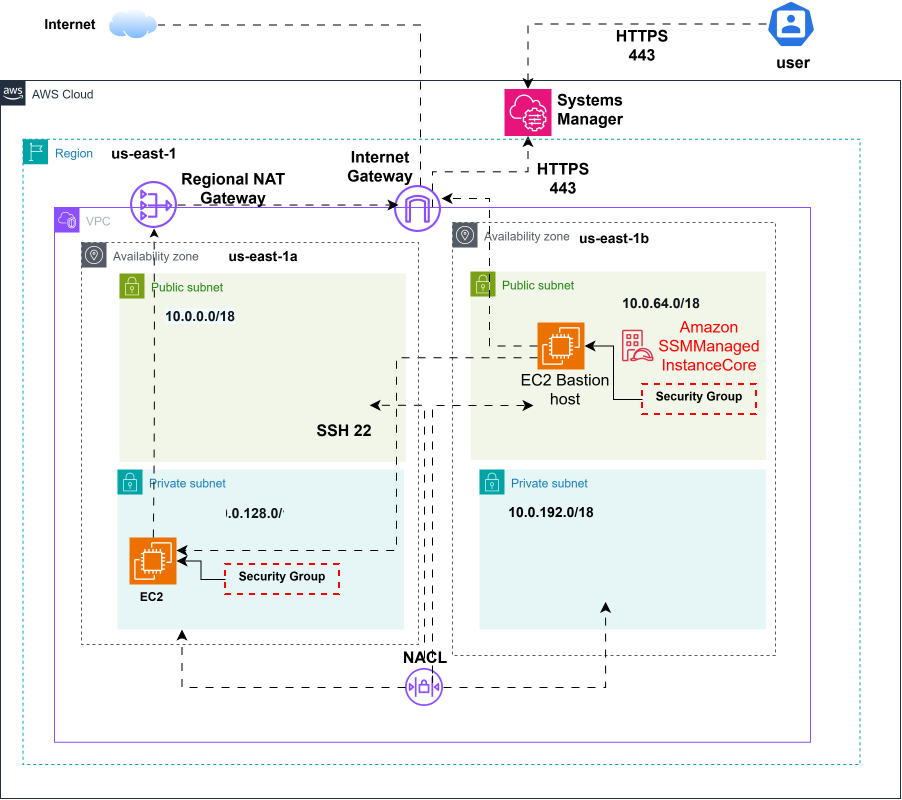](docs/architecture.drawio.svg)

## Traffic Flows

1. **User → Systems Manager**: HTTPS 443, from the console (Session Manager) or `aws ssm start-session`
2. **Bastion SSM Agent → Internet Gateway → Systems Manager**: outbound HTTPS 443
3. **Bastion → app-1a**: SSH 22 on the private IP
4. **app-1a → private-rt → Regional NAT Gateway → Internet Gateway → Internet**: outbound only

## Network Design

### VPC

| Name | VPC ID | CIDR |
|---|---|---|
| `myvpc` | `vpc-0f43e88a60f7ca186` | `10.0.0.0/16` |

### Subnets

| Name | AZ | CIDR | Route table |
|---|---|---|---|
| `public-1a` | us-east-1a | `10.0.0.0/18` | `public-rt` |
| `public-1b` | us-east-1b | `10.0.64.0/18` | `public-rt` |
| `private-1a` | us-east-1a | `10.0.128.0/18` | `private-rt` |
| `private-1b` | us-east-1b | `10.0.192.0/18` | `private-rt` |

### Route Tables

A subnet is public or private only because of the route table associated with it.

**`public-rt`** (`rtb-01023556a183f4291`), associated with `public-1a` and `public-1b`

| Destination | Target |
|---|---|
| `10.0.0.0/16` | local |
| `0.0.0.0/0` | `igw-01b4f5e678e50ff5b` (myigw) |

**`private-rt`** (`rtb-0de58e66574605383`), associated with `private-1a` and `private-1b`

| Destination | Target |
|---|---|
| `10.0.0.0/16` | local |
| `0.0.0.0/0` | `nat-14550ab56261e0c51` (Regional NAT Gateway) |

- The **local** route is created automatically; it lets the bastion reach `app-1a` inside the VPC.
- With a **Regional NAT Gateway**, one private route table serves both AZs. With zonal NAT Gateways, each AZ would need its own private route table pointing to its own NAT.
- The VPC also shows two route tables not associated with any subnet: the **main route table** created with the VPC, and **`rtb-0ee00cfd80b8b2a24`**, which AWS creates automatically for the Regional NAT Gateway with a preconfigured route to the internet gateway.

### Regional NAT Gateway

| Setting | Value |
|---|---|
| NAT Gateway ID | `nat-14550ab56261e0c51` |
| Availability mode | **Regional** |
| Connectivity type | Public |
| EIP allocation | Automatic |
| Public IP in us-east-1a | `54.84.111.190` |
| Public IP in us-east-1b | `52.87.27.115` |

The NAT is not placed in a public subnet: it lives at the VPC level and allocated one Elastic IP per Availability Zone where workloads run.

### Security Groups

| Security Group | Inbound | Outbound |
|---|---|---|
| **`bastion`** (`sg-05ab6ed82ca0c57df`) | none | HTTPS 443 → `0.0.0.0/0` (SSM agent), SSH 22 → `app-1a` SG |
| **`app-1a`** (`sg-0cf7f2eb95f13a8b1`) | SSH 22 ← `bastion` SG | default |

### Network ACL

The VPC uses its **default NACL** (`acl-0acd1c110b736e66b`), associated with the 4 subnets. Filtering is done at the security group level.

### Instances

| Name | Subnet | AZ | Public IP | Role |
|---|---|---|---|---|
| `bastion` | `public-1b` (`10.0.112.43`) | us-east-1b | yes | jump host, SSM managed node |
| `app-1a` | `private-1a` (`10.0.154.235`) | us-east-1a | none | application instance |

## Connect to the Instances

```bash
# 1. Open a session on the bastion (console: Systems Manager → Session Manager → Start session)
aws ssm start-session --target i-056af3d85e3267a6b

# 2. From the bastion, jump to the private instance
ssh -i test.pem ec2-user@10.0.154.235

# 3. Check the outbound path: returns the Regional NAT's IP for us-east-1a
curl -s ifconfig.me; echo
# 54.84.111.190
```

## Project Structure

```
aws-custom-vpc-ssm/
├── README.md
├── .gitignore
├── docs/
│   └── architecture.drawio.svg
└── screenshots/
    ├── 01-vpc.png
    ├── 02-resource-map.png
    ├── 03-subnets.png
    ├── 04-igw.png
    ├── 05-nat-gateway-regional.png
    ├── 06-public-rt-routes.png
    ├── 07-public-rt-associations.png
    ├── 08-private-rt-routes.png
    ├── 09-private-rt-associations.png
    ├── 10-bastion-sg-inbound.png
    ├── 11-bastion-sg-outbound.png
    ├── 12-app-sg-inbound.png
    ├── 13-iam-role.png
    ├── 14-ec2-instances.png
    ├── 15-fleet-manager.png
    ├── 16-session-manager.png
    ├── 17-nacl.png
    └── 18-ssh-and-nat-egress.png
```

## Key Components

### VPC and Subnets
- **VPC** `myvpc`: `10.0.0.0/16`, split into four `/18` subnets across two AZs
- **Public subnets**: host the bastion and route to the Internet Gateway
- **Private subnets**: host the application instance, with no public IP

### Internet Gateway and Regional NAT Gateway
- **Internet Gateway** `myigw`: entry and exit point for the public subnets
- **Regional NAT Gateway**: created in *Regional* availability mode at the VPC level; it expands automatically to every AZ where workloads run and allocates one Elastic IP per AZ

### Systems Manager Session Manager
- **SSM Agent**: preinstalled on Amazon Linux, connects outbound on 443
- **IAM role** `ssm`: `AmazonSSMManagedInstanceCore`, attached through the `ssm` instance profile
- **Benefits**: no inbound port, no SSH key needed to reach the bastion, and every session is recorded in AWS

### Security
- **Security groups**: least privilege; `app-1a` accepts SSH only from the `bastion` security group
- **Network ACL**: default NACL on all 4 subnets

## Deployment Steps

1. **Network**
   - Create `myvpc` with `10.0.0.0/16`
   - Create `public-1a`, `public-1b`, `private-1a`, `private-1b`
   - Create `myigw` and attach it to `myvpc`
2. **Routing**
   - Create the NAT Gateway with availability mode **Regional** and automatic EIP allocation
   - Create `public-rt` with `0.0.0.0/0` → `myigw`, and associate it with both public subnets
   - Create `private-rt` with `0.0.0.0/0` → Regional NAT Gateway, and associate it with both private subnets
3. **Security**
   - Create the `bastion` security group with no inbound rules, and outbound 443 to `0.0.0.0/0` plus 22 to the `app-1a` security group
   - Create the `app-1a` security group with inbound 22 from the `bastion` security group
   - Create the IAM role `ssm` for EC2 with `AmazonSSMManagedInstanceCore`
4. **Compute and Access**
   - Launch `bastion` in `public-1b` with a public IP and the `ssm` instance profile
   - Launch `app-1a` in `private-1a` without a public IP
   - Check that `bastion` is **Online** in Fleet Manager
   - Start a Session Manager session on `bastion`, then SSH to `app-1a`

## Demonstration

### VPC
[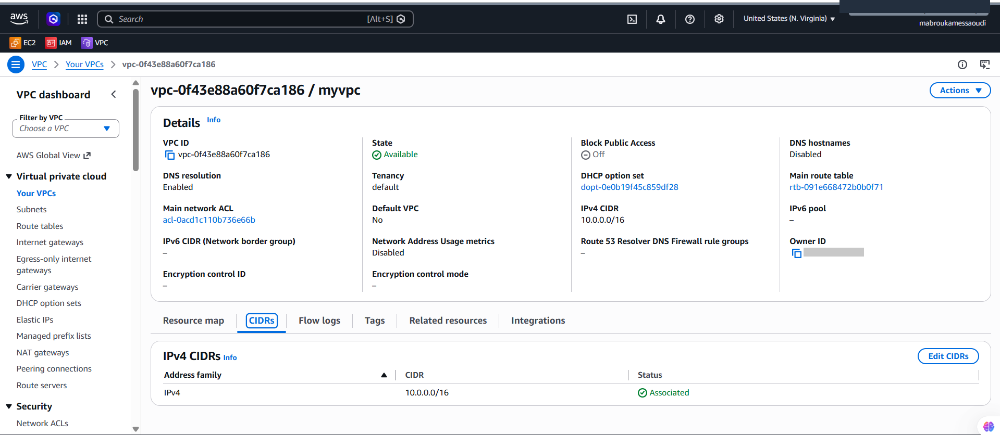](screenshots/01-vpc.png)

### Resource Map
[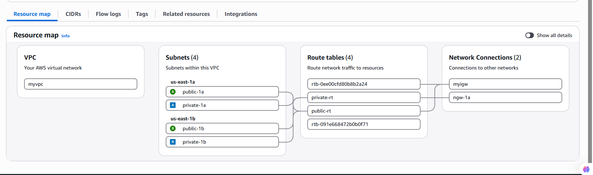](screenshots/02-resource-map.png)

### Subnets
[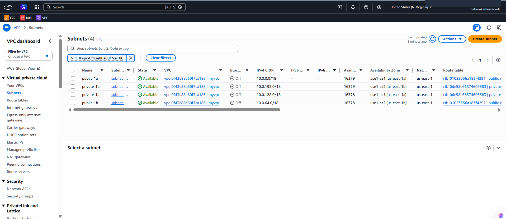](screenshots/03-subnets.png)

### Internet Gateway
[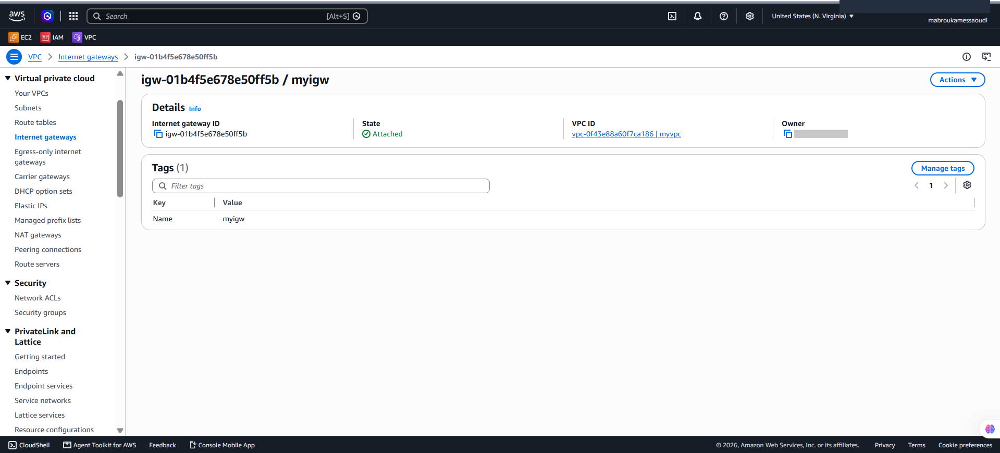](screenshots/04-igw.png)

### Regional NAT Gateway
[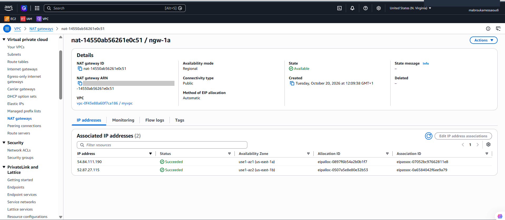](screenshots/05-nat-gateway-regional.png)

### Public Route Table: Routes
[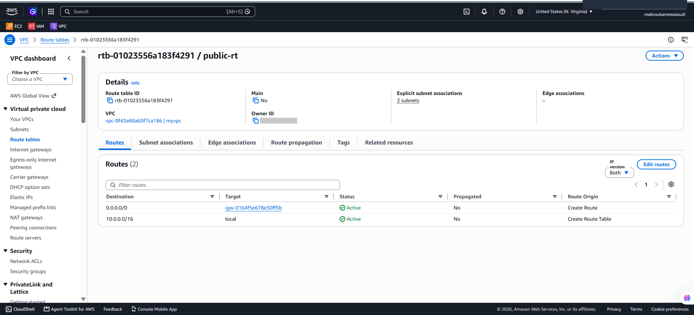](screenshots/06-public-rt-routes.png)

### Public Route Table: Subnet Associations
[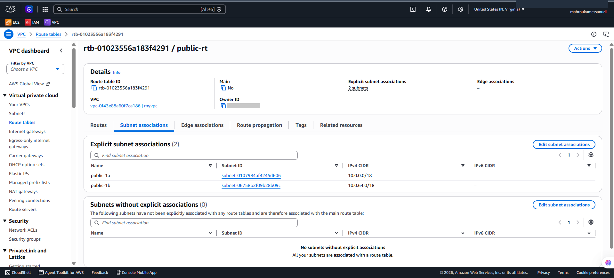](screenshots/07-public-rt-associations.png)

### Private Route Table: Routes
[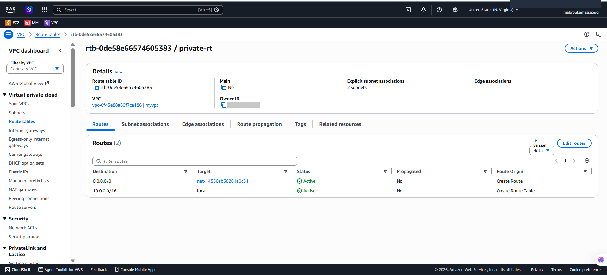](screenshots/08-private-rt-routes.png)

### Private Route Table: Subnet Associations
[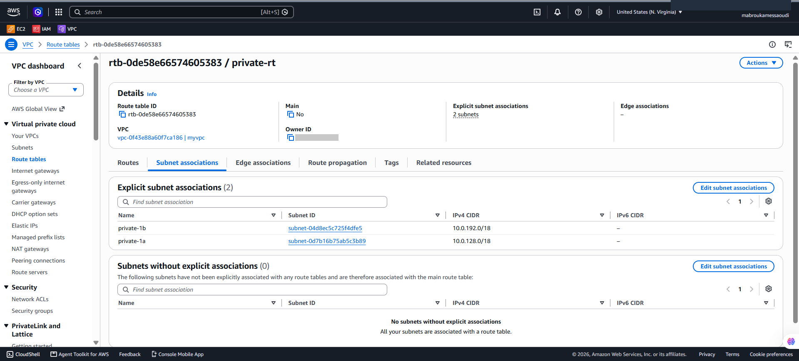](screenshots/09-private-rt-associations.png)

### Bastion Security Group: No Inbound Rules
[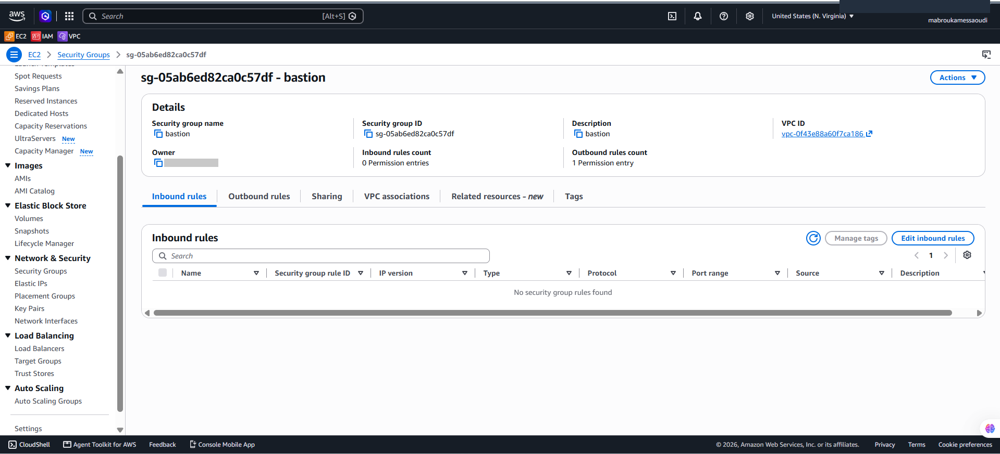](screenshots/10-bastion-sg-inbound.png)

### Bastion Security Group: Outbound Rules
[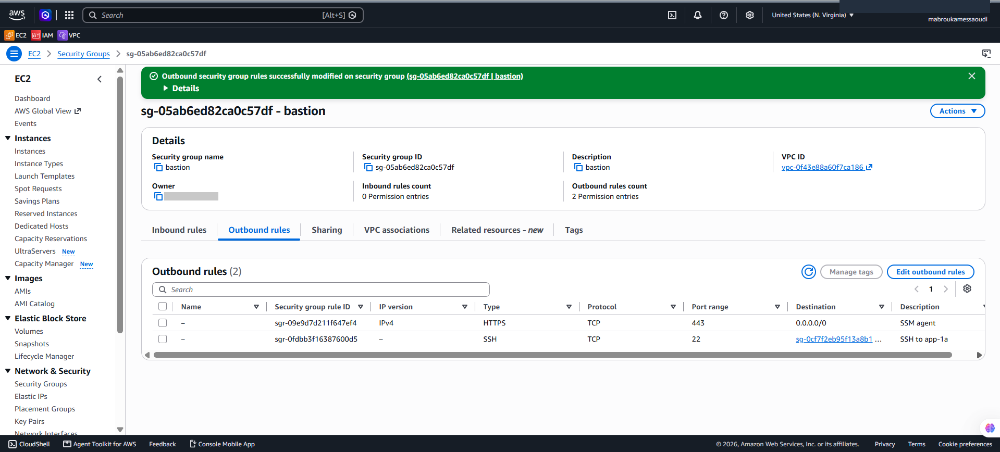](screenshots/11-bastion-sg-outbound.png)

### App Security Group: SSH from Bastion Only
[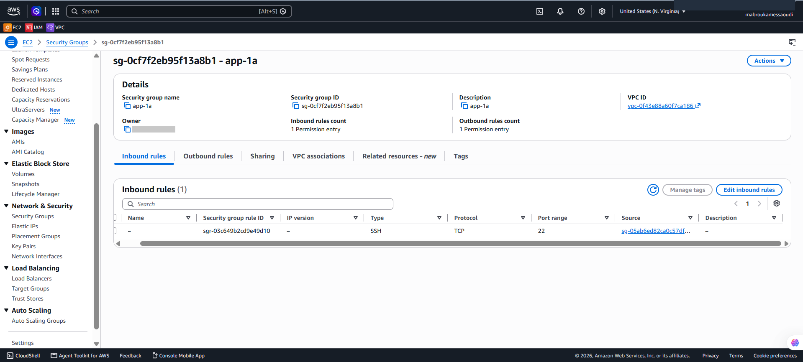](screenshots/12-app-sg-inbound.png)

### IAM Role
[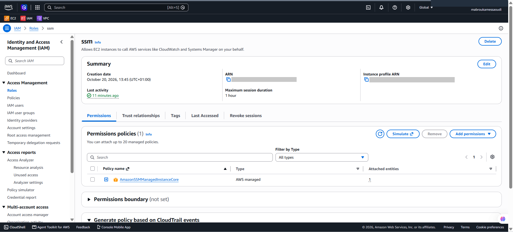](screenshots/13-iam-role.png)

### EC2 Instances
[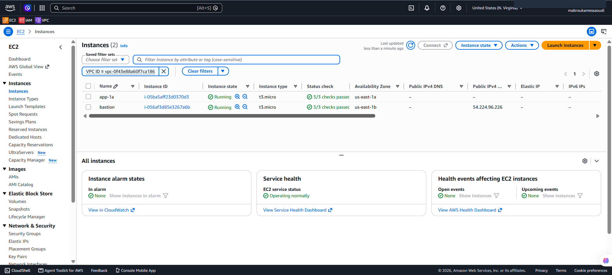](screenshots/14-ec2-instances.png)

### Fleet Manager: Bastion Online
[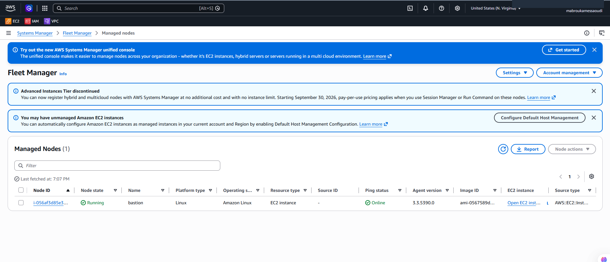](screenshots/15-fleet-manager.png)

### Session Manager Session on the Bastion
[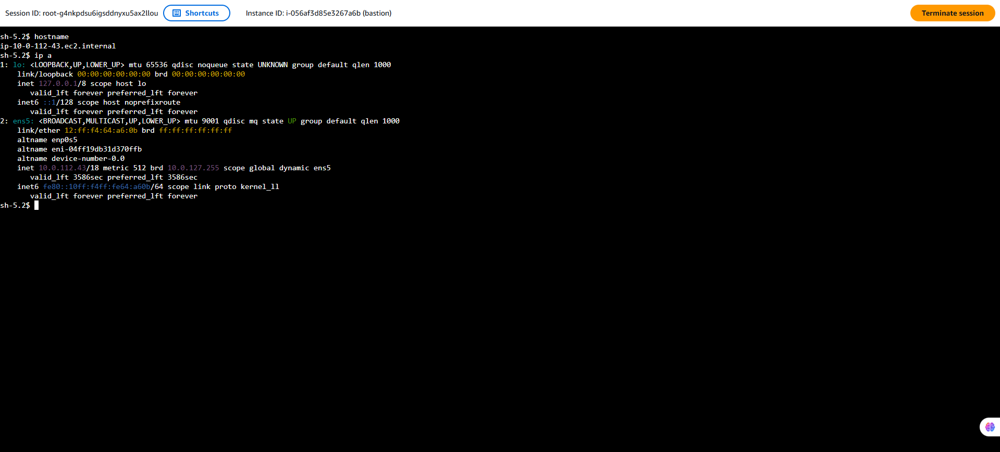](screenshots/16-session-manager.png)

### Network ACL
[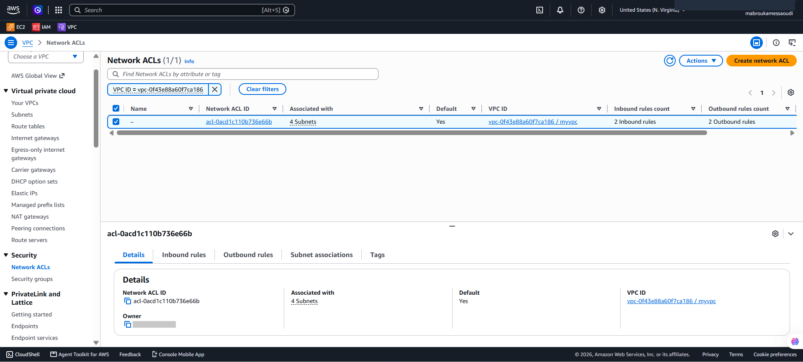](screenshots/17-nacl.png)

### SSH from the Bastion to app-1a, then Outbound Through the Regional NAT Gateway
From the bastion (`10.0.112.43`), SSH reaches `app-1a` on its private IP `10.0.154.235`. From `app-1a`, `curl ifconfig.me` returns `54.84.111.190`, the Regional NAT Gateway's Elastic IP for us-east-1a: the instance has no public IP, and its traffic leaves through the NAT in its own AZ.

[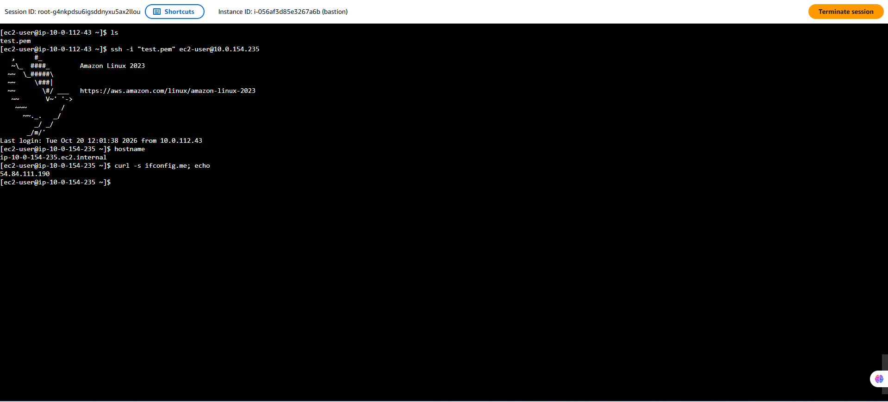](screenshots/18-ssh-and-nat-egress.png)

## Possible Improvements

- Use **Session Manager port forwarding** (`AWS-StartPortForwardingSessionToRemoteHost`) so the SSH key never leaves the local machine
- Replace internet access to SSM with **VPC interface endpoints** (`ssm`, `ssmmessages`, `ec2messages`)
- Remove the bastion and enable Session Manager directly on the private instance
- Rebuild the whole infrastructure with **Terraform**

